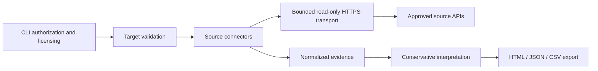

# Architecture and evidence contracts

## Module responsibilities

| Module | Responsibility |
| --- | --- |
| `targets` | Canonical public IP or IDNA domain; reject URL syntax, control/whitespace, reserved suffixes and private addresses |
| `transport` | Fixed HTTPS destinations, GET only, verified TLS, streamed 2 MB response cap, explicit 32-level JSON nesting bound, bounded retries and source pacing |
| `connectors` | Provider-specific endpoints/authentication and selected normalized fields |
| `models` | UTC retrieval timestamps, provenance, explicit availability state |
| `assessment` | Evidence-backed informational/review findings without unsupported risk scoring |
| `reporting` | Self-contained escaped HTML, JSON, formula-safe CSV; secret redaction and exclusive output creation |
| `cli` | Scope/licensing acknowledgement, environment keys, orchestration and exit semantics |

## Implemented API contracts

| Source | Existing-record GET | Authentication |
| --- | --- | --- |
| RDAP | `https://rdap.org/domain/{domain}` or `/ip/{ip}` | None |
| Shodan | `https://api.shodan.io/shodan/host/{ip}` or `/dns/domain/{domain}` | `key` query parameter, as required by Shodan |
| VirusTotal v3 | `https://www.virustotal.com/api/v3/domains/{domain}` or `/ip_addresses/{ip}` | `x-apikey` header |

RDAP follows up to three HTTPS redirects only among curated registry hosts: rdap.org, rdap.verisign.com, rdap.publicinterestregistry.org, rdap.arin.net, rdap.db.ripe.net, rdap.apnic.net, rdap.lacnic.net and rdap.afrinic.net. API credentials are never redirected. Supporting another registry requires reviewing and testing a source-code allowlist addition. The environment egress policy independently must permit the destination. Redirects to target-controlled hosts and arbitrary link traversal are not supported.

Source documentation references (not successfully fetched in this environment):

- [RDAP protocol, RFC 9082](https://www.rfc-editor.org/rfc/rfc9082)
- [RDAP JSON responses, RFC 9083](https://www.rfc-editor.org/rfc/rfc9083)
- [RDAP bootstrap service](https://rdap.org/)
- [Shodan REST API](https://developer.shodan.io/api)
- [VirusTotal API v3](https://docs.virustotal.com/reference/overview)
- [VirusTotal public versus premium terms](https://docs.virustotal.com/reference/public-vs-premium-api)

The official [Shodan Python client](https://github.com/achillean/shodan-python/blob/master/shodan/client.py) was retrieved and inspected: host/domain paths and query-key authentication match this implementation. The official [VirusTotal Python client](https://github.com/VirusTotal/vt-py/blob/master/vt/client.py) was retrieved and inspected: the HTTPS API v3 prefix and X-Apikey authentication match. Shodan IP requests use `minify=true` to avoid retrieving service banners, and domain requests explicitly use page 1. Provider documentation pages remain blocked by environment egress. Contracts are mocked and still need genuine authorized acceptance testing before claiming live verification.

## Evidence schema 1.0

The assessment contains `schema_version`, `mode`, `generated_at`, `target`, `summary`, `findings` and `evidence`. Each evidence record includes `source`, `status`, canonical `target`, credential-free `endpoint`, UTC `collected_at`, selected `observations`, sanitized `message` and explicit analyst `verification` guidance.

Status meanings:

- `observed`: a record was retrieved and normalized. Confirms source response only.
- `unavailable`: missing key, entitlement, no record, blocked/unapproved redirect, exhausted rate-limit/connection retries. Does not prove absence of exposure.
- `error`: unusable JSON/schema, response size violation, or an unexpected HTTP status. No finding is inferred.

Analyst items are informational indexed ports or review-required vendor detections. Neither is called a confirmed vulnerability. Source staleness, asset ownership and false positives require separate approved verification. Provider registration events and last-analysis/update timestamps remain in observations. Retrieval timestamp is independent of those dates.

## Failure handling and resource limits

Connect/read timeouts: 5/20 seconds. Three attempts by default, bounded to 1–5 at library construction. Retries apply to network exceptions, HTTP 429 and 5xx; other statuses fail immediately. Exponential waits are bounded; numeric and HTTP-date Retry-After values up to 60 seconds are honored and longer requested waits return unavailable for later operator retry. Source pacing is one second for Shodan and 15 seconds for VirusTotal within a transport instance. Daily/account quotas and pacing across processes are operator responsibilities. Sequential CLI collection avoids intra-process quota races. A timeout applies to individual socket operations; slow streaming and the complete multi-source job have no global wall-clock deadline.

## Security boundaries

No target DNS lookups or target HTTP/socket requests occur. Authorization flags record operator acknowledgement; they cannot prove external legal approval. Source endpoints are fixed and target validation blocks path/query injection. Requests retain normal TLS verification and inherited proxy trust. No request/response logging is installed; sanitized provider errors exclude raw bodies and exception text. Reports remove configured key strings recursively, escape HTML, disable external content through CSP and neutralize spreadsheet formulas. Keys are never stored in an evidence object. Avoid enabling third-party HTTP debug logging because Shodan requires a query-string key.

Reports preserve only selected provider fields, not full raw responses, and are not signed chain-of-custody archives. Fixed output files are created exclusively to avoid symlink following and overwriting existing files. Operators must trust and protect the parent output directory. Reports have restrictive creation modes where supported; Windows ACLs require separate administration. Environment variables remain accessible to the process owner and are not a substitute for a production secret manager.
