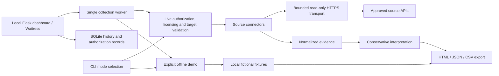

# Architecture and evidence contracts

## Module responsibilities

| Module | Responsibility |
| --- | --- |
| `targets` | Canonical public IP or IDNA domain; reject URL syntax, control/whitespace, reserved suffixes and private addresses |
| `transport` | Fixed HTTPS destinations, GET only, verified TLS, streamed 2 MB response cap, explicit 32-level JSON nesting bound, bounded retries and source pacing |
| `connectors` | Provider-specific endpoints/authentication and selected normalized fields |
| `demo` | Fixed fictional scenario and synthetic evidence/findings; no transport, connector or live assessment imports |
| `models` | UTC retrieval timestamps, provenance, explicit availability state |
| `assessment` | Evidence-backed informational/review findings without unsupported risk scoring |
| `reporting` | Self-contained escaped HTML, JSON, formula-safe CSV; secret redaction and exclusive output creation |
| `cli` | Scope/licensing acknowledgement, environment keys, orchestration and exit semantics |
| `web` | Loopback Flask routes, validation, CSRF/origin checks, single-worker collection and browser status polling |
| `store` | Parameterized SQLite history, authorization metadata, interrupted-job recovery and explicit record deletion |

## Implemented API contracts

| Source | Existing-record GET | Authentication |
| --- | --- | --- |
| RDAP | `https://rdap.org/domain/{domain}` or `/ip/{ip}` | None |
| Shodan | `https://api.shodan.io/shodan/host/{ip}` or `/dns/domain/{domain}` | `key` query parameter, as required by Shodan |
| VirusTotal v3 | `https://www.virustotal.com/api/v3/domains/{domain}` or `/ip_addresses/{ip}` | `x-apikey` header |

RDAP follows up to three HTTPS redirects only among curated registry hosts: rdap.org, rdap.verisign.com, rdap.publicinterestregistry.org, rdap.arin.net, rdap.db.ripe.net, rdap.apnic.net, rdap.lacnic.net and rdap.afrinic.net. API credentials are never redirected. Supporting another registry requires reviewing and testing a source-code allowlist addition. The environment egress policy independently must permit the destination. Redirects to target-controlled hosts and arbitrary link traversal are not supported.

Source documentation references (not successfully fetched in this environment):

- [RDAP protocol, RFC 9082](https://www.rfc-editor.org/rfc/rfc9082)
- [RDAP JSON responses, RFC 9083](https://www.rfc-editor.org/rfc/rfc9083)
- [RDAP bootstrap service](https://rdap.org/)
- [Shodan REST API](https://developer.shodan.io/api)
- [VirusTotal API v3](https://docs.virustotal.com/reference/overview)
- [VirusTotal public versus premium terms](https://docs.virustotal.com/reference/public-vs-premium-api)

The official [Shodan Python client](https://github.com/achillean/shodan-python/blob/master/shodan/client.py) was retrieved and inspected: host/domain paths and query-key authentication match this implementation. The official [VirusTotal Python client](https://github.com/VirusTotal/vt-py/blob/master/vt/client.py) was retrieved and inspected: the HTTPS API v3 prefix and X-Apikey authentication match. Shodan IP requests use `minify=true` to avoid retrieving service banners, and domain requests explicitly use page 1. Provider documentation pages remain blocked by environment egress. Contracts are mocked and still need genuine authorized acceptance testing before claiming live verification.

## Evidence schema 1.0

The assessment contains `schema_version`, `mode`, `generated_at`, `target`, `summary`, `findings` and `evidence`. Each evidence record includes `source`, `status`, canonical `target`, credential-free `endpoint`, UTC `collected_at`, selected `observations`, sanitized `message` and explicit analyst `verification` guidance.

Status meanings:

- `observed`: a record was retrieved and normalized. Confirms source response only.
- `unavailable`: missing key, entitlement, no record, blocked/unapproved redirect, exhausted rate-limit/connection retries. Does not prove absence of exposure.
- `error`: unusable JSON/schema, response size violation, or an unexpected HTTP status. No finding is inferred.

Analyst items are informational indexed ports or review-required vendor detections. Neither is called a confirmed vulnerability. Source staleness, asset ownership and false positives require separate approved verification. Provider registration events and last-analysis/update timestamps remain in observations. Retrieval timestamp is independent of those dates.

## Failure handling and resource limits

Connect/read timeouts: 5/20 seconds. Three attempts by default, bounded to 1–5 at library construction. Retries apply to network exceptions, HTTP 429 and 5xx; other statuses fail immediately. Exponential waits are bounded; numeric and HTTP-date Retry-After values up to 60 seconds are honored and longer requested waits return unavailable for later operator retry. Source pacing is one second for Shodan and 15 seconds for VirusTotal within a transport instance. Daily/account quotas and pacing across processes are operator responsibilities. Sequential CLI collection avoids intra-process quota races. A timeout applies to individual socket operations; slow streaming and the complete multi-source job have no global wall-clock deadline.

## Security boundaries

No target DNS lookups or target HTTP/socket requests occur. Authorization flags record operator acknowledgement; they cannot prove external legal approval. Source endpoints are fixed and target validation blocks path/query injection. Connectors repeat validation for library callers, reject scoped IPv6, and require matching source identities; RDAP network ranges must contain the target. Requests retain normal TLS verification and inherited proxy trust. No request/response logging is installed; sanitized provider errors exclude raw bodies and exception text. Provider JSON rejects non-finite numbers and invalid Unicode. Reports remove configured key strings recursively, longest key first, escape HTML, disable external content through CSP and neutralize spreadsheet formulas. Keys are never stored in an evidence object. Avoid enabling third-party HTTP debug logging because Shodan requires a query-string key.

Reports preserve only selected provider fields, not full raw responses, and are not signed chain-of-custody archives. Fixed output files are created exclusively to avoid symlink following and overwriting existing files. Operators must trust and protect the parent output directory. Reports have restrictive creation modes where supported; Windows ACLs require separate administration. Environment variables remain accessible to the process owner and are not a substitute for a production secret manager.

## Offline demonstration boundary

`--demo` selects `demo.build_demo_report` before any API-key lookup or Transport construction. Its fixed reserved `.example` domain and RFC 5737 documentation IP cannot pass live target validation. The demo module imports only the UTC timestamp helper, creates fresh fixture dictionaries on each call and never invokes the live assessment engine or connectors. It does not resolve identifiers, query providers, submit analyses or require API licensing because no provider is used. Mixed target/source/authorization/license flags are rejected.

Demo JSON schema 1.1 carries explicit top-level and per-record/per-finding `is_synthetic` and `data_classification` metadata. Source status is `synthetic`, not `observed`; actual observed sources remain 0. Fixed source/fixture dates are clearly separate from real report `generated_at`. The HTML uses one concise training banner, compact per-card synthetic badges/classification attributes, fictional scope and synthetic timestamp descriptions. No live authorization claim is rendered for a demonstration.

Exports share the escaped renderer, formula-safe CSV writer and exclusive file creation. The exporter refuses synthetic evidence under a live mode or non-synthetic records/findings in a demo. Live JSON schema 1.0 and existing source states remain unchanged. CSV retains its original columns and adds `mode`, `data_classification`, `findings` (JSON array), `record_target` and `timestamp_kind`; the source-linked findings carry their own provenance. Consumers should parse columns by name. No automatic fallback from a failed live call to the demo exists.

## Local dashboard architecture

`osint-dashboard` runs the Flask application through Waitress on fixed host `127.0.0.1` (default port 8765). Routes render packaged, escaped Jinja templates and local CSS/JavaScript; no CDN or external font is required. The dashboard calls existing `RDAP`, `Shodan`, `VirusTotal`, `assess`, `build_demo_report` and `export_report` functions rather than maintaining a second intelligence engine. A single background worker maintains one live Transport instance so its provider pacing continues across assessments in the same process. The pending queue is capped at five assessments. Separate processes/accounts are not coordinated; do not share one data directory between running dashboards or bypass provider account quotas with concurrent CLI runs.

Each new live submission validates its target/sources, records a scope-reference and authorization acknowledgement with target, selected sources, license declaration and timestamp, then collects fresh source records. Report mode remains `live-source retrieval`, including when every source is unavailable. Demo submissions reject live inputs, use fixed fictional records and never instantiate transport or call providers. Mode is stored separately for history as `live` or `demo` and cannot be relabelled through a UI control.

The SQLite store defaults to `~/.osint-recon/assessments.sqlite3`. New directories/files request POSIX modes 0700/0600; existing paths and Windows ACLs require operator review. Reports are redacted before persistence and display. Failed runs retain submitted authorization metadata; raw exception strings, API request credentials and raw provider bodies are not stored. Evidence JSON means normalized selected fields returned by a source, not the entire unfiltered API payload. Source registration entities and banners remain intentionally minimized.

History lists the newest 100 records without automatic pruning. Parameterized queries and validated opaque IDs restrict lookup/deletion. Finished/error records can be removed through CSRF-protected POST; active ones cannot. On startup, queued/running records left by a stopped process are marked error and require an explicitly new assessment. Processes, jobs and signed-cookie sessions are not restored from persistent history.

Browser responses use a restrictive same-origin CSP, no-store caching, no-referrer, nosniff and frame denial. POST actions require a signed-session CSRF token, acceptable Host/Origin and loopback client address; cross-site Fetch Metadata is rejected. API keys are never accepted through the browser and only binding presence is displayed. Session secrets rotate at startup; cookies are HttpOnly and SameSite Strict. Secure-cookie mode is not used on the intentional local HTTP endpoint. These are single-user loopback protections, not an authentication/authorization system for a publicly accessible or multi-user service.

Standalone HTML exports remain self-contained: native disclosure panels, source-backed charts, normalized JSON, readable UTC timestamps and explicit A4 white print rules. JSON/CSV retain structured provenance. The dashboard offers per-assessment HTML/JSON/CSV downloads, but does not sign evidence or provide cryptographic chain of custody. See [dashboard operations](DASHBOARD.md) and [validation](WEB_VALIDATION.md).
