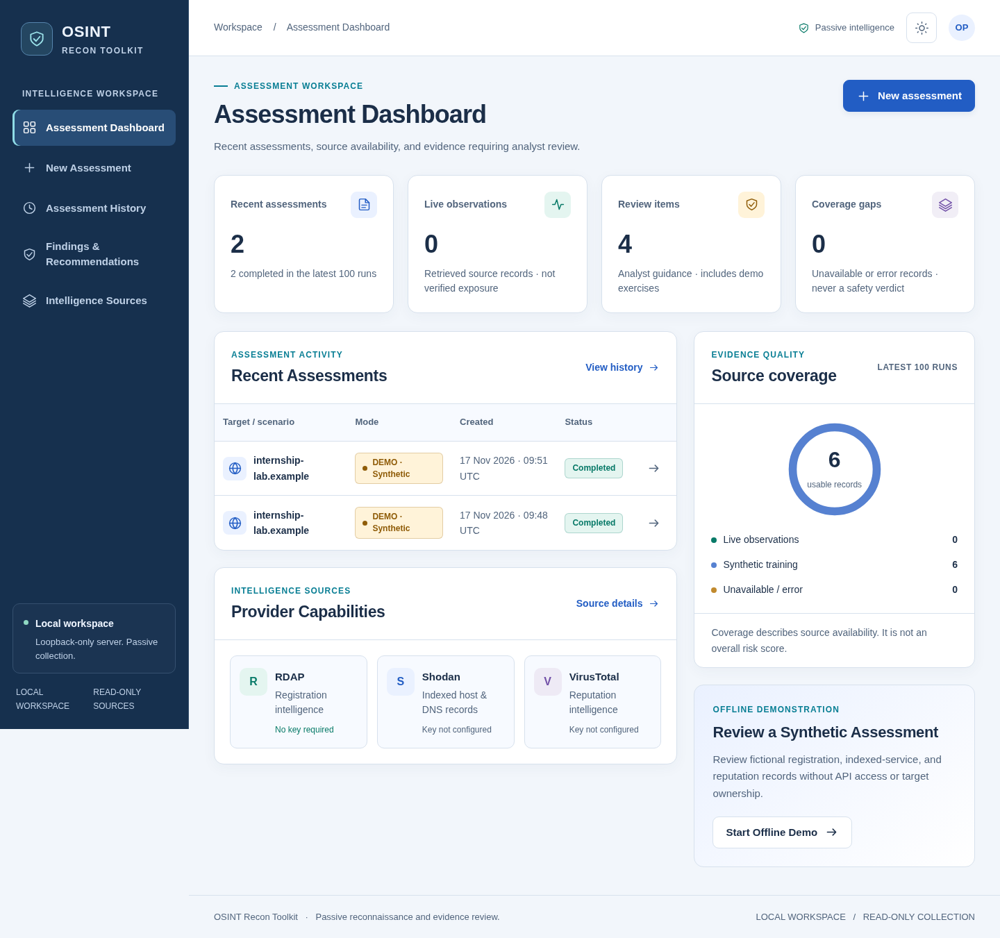
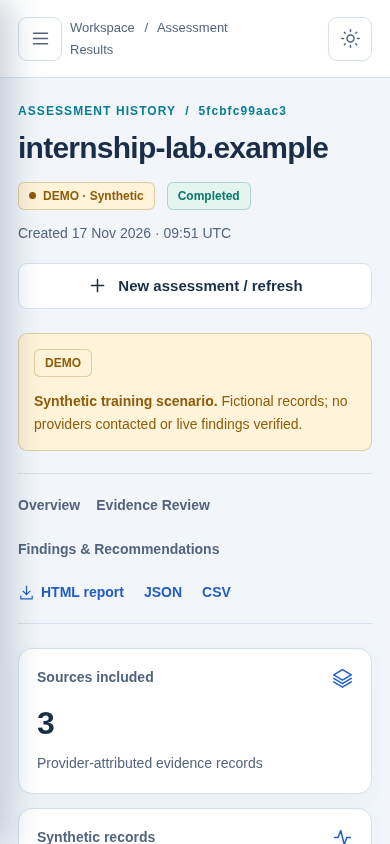
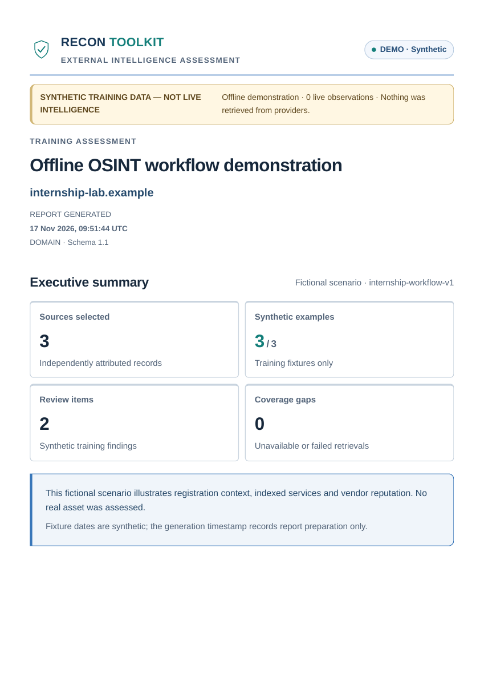

# OSINT operations workbook

A structured workbook for authorized public-source reconnaissance, evidence review and reporting using OSINT Recon Toolkit. It supports supervised teaching and preparation for a small authorized external reconnaissance mini-audit. It does not certify commercial readiness, establish legal authority or replace an engagement methodology.

The application remains a local Python CLI and Flask/Waitress dashboard. The visual redesign does not change the collection engine, SQLite history, API contracts or security controls. Genuine provider acceptance is still unverified; the exercises below use synthetic records only.

## 1. Purpose, boundaries and terminology

Open-source intelligence is the collection and interpretation of information from permitted sources to answer a defined question. In this toolkit, **passive collection** means retrieving existing records from fixed RDAP, Shodan and VirusTotal endpoints. The application does not contact target services, resolve target DNS itself, scan ports, submit analyses or rescans, exploit a target, authenticate to target accounts or collect credentials.

| Term | Meaning in this application |
| --- | --- |
| Scope | Exact approved domain/public IP, sources, purpose, time window and handling conditions |
| Observation | A selected field from a retrieved provider record; not independently verified truth |
| Source coverage | Which selected sources returned usable records; not a security score |
| Finding / review item | Conservative analyst guidance supported by evidence, or an explicitly synthetic exercise |
| Unavailable | Missing credential/entitlement, no record, failed access or exhausted service retries; not evidence of safety |
| Error | Unusable schema/JSON, target mismatch, size/format violation or unexpected failure |
| Demo | Fixed fictional training workflow with no provider requests and zero live observations |

The three API sources describe limited parts of an attack surface. This is not an exhaustive asset inventory, vulnerability scanner or proof of present exposure.

## 2. Ethical authorization and scope definition

Before Live collection:

1. Complete the [scope and authorization form](SCOPE_AUTHORIZATION_FORM.md) with an authorized approver.
2. Confirm the exact target, permitted sources, purpose, dates, privacy handling, retention and report recipients.
3. Review actual provider account entitlements and current terms. Do not assume an internship, public record or discovered relationship creates permission.
4. Retain written approval externally and enter only its nonsecret reference in the dashboard.
5. Recheck the scope for every new run. Related hostnames/IPs in a result do not expand it.

The tool accepts a single domain or public unicast IPv4/IPv6 address. It rejects URLs, paths, ports, ranges, wildcard syntax, private/local addresses, zone identifiers and reserved example suffixes. Syntax validation does not verify ownership or legal permission. The dashboard records acknowledgement, reference, target, selected sources, license declaration and time; those records are not signatures or legal proof.

If no approved real target is available, use Demo. Do not invent an authorization reference to make a training query look live.

## 3. Development environment and installation

Requirements: Python 3.10 or later, Git and a supported local browser. Installation may require Internet access. Runtime Demo uses packaged local assets and does not need source connectivity or keys.

### New Mac checkout

Use a new Terminal window and an unused destination directory:

```sh
git clone --branch feature/professional-workspace-redesign https://github.com/masud1445/osint-recon-toolkit.git
cd osint-recon-toolkit
python3 -m venv .venv
source .venv/bin/activate
python -m pip install -e '.[test]'
osint-dashboard
```

Keep that Terminal running. In another tab:

```sh
open http://127.0.0.1:8765
```

For an existing clone, preserve local work before switching. From a clean working tree, fetch, switch to `feature/professional-workspace-redesign`, activate its virtual environment and reinstall. Do not reset or clone over existing work. See [dashboard instructions](DASHBOARD.md) for update commands and optional `--port`/`--data-dir` settings.

On Linux, activate with `source .venv/bin/activate`. On Windows PowerShell, activate with `.venv\Scripts\Activate.ps1`. The underlying package and tests are portable; no real-device browser certification is claimed.

### Validate the environment

```sh
python -m pytest --cov=osint_recon --cov-report=term-missing
python -m pip check
```

Use the final commit's [professional validation record](PROFESSIONAL_VALIDATION.md) for actual counts, viewport checks and CI evidence. Do not cite historical reports as verification of a newer commit.

## 4. Registration intelligence: RDAP and WHOIS

RDAP is structured registration data retrieved over HTTPS. Traditional WHOIS uses a different protocol and free-text responses; terminology and available fields vary by registry. The supervisor's registration-intelligence objective can be met by explaining this relationship and using RDAP for permitted domain/IP records. The application does **not** implement legacy port-43 WHOIS interoperability.

| Familiar WHOIS concept | RDAP / toolkit evidence | Qualification |
| --- | --- | --- |
| Queried domain | `ldhName` | Canonical domain identity must match the request |
| Registration identifier | `handle` | Identifier, not ownership validation |
| Domain status | `status` array | Registry/provider record state |
| Creation, update or expiry dates | `events[].eventAction` and `eventDate` | Display only events actually supplied; do not invent missing dates |
| Nameservers | `nameservers[].ldhName` or `unicodeName` where present | Registration metadata; no follow-up lookup is implied |
| Allocated IP range | `startAddress`, `endAddress`, `ipVersion` | Returned range must contain the requested IP |
| Network name/country | `name`, `country` where present | Context from the record; not verified physical location |
| Registrant, administrative contacts, registrar entities | Not collected by this normalization | Personal contact entities and vCards are deliberately omitted; this is not complete WHOIS field parity |
| Original free-text WHOIS response | Not available | Exports contain normalized selected JSON fields, not legacy WHOIS text |

There is no automatic plaintext fallback, arbitrary registry URL traversal or unapproved target endpoint. RDAP redirects are limited to curated registry hosts; an unsupported registry produces an honest coverage gap. Do not disable validation or add a port-43 client simply to make a label say WHOIS. If literal WHOIS-protocol compatibility is a grading criterion, obtain the supervisor's clarification and design a separate reviewed requirement before changing network behavior.

Protocol references: [RDAP queries, RFC 9082](https://www.rfc-editor.org/rfc/rfc9082), [RDAP responses, RFC 9083](https://www.rfc-editor.org/rfc/rfc9083), and [traditional WHOIS, RFC 3912](https://www.rfc-editor.org/rfc/rfc3912). These links identify relevant specifications; this workbook does not claim that the latest external documentation was fetched or live behavior verified during the redesign.

## 5. Shodan and VirusTotal

### Shodan

The connector retrieves existing host metadata for an IP or domain/DNS information for a domain. IP requests use the provider's minimal response option rather than collecting service banners. Selected fields can include indexed ports, hostnames, organization, ASN, update time and DNS records. Domain collection is limited to the first page; the provider's `more` indicator is preserved when supplied.

An indexed port is not a new scan and does not prove current reachability or a vulnerability. Shodan domain access can require a suitable subscription. Missing/invalid credentials, plan restrictions and no records are coverage limitations, not successful negative assessments.

### VirusTotal

The v3 connector retrieves existing domain/IP objects; it never uploads a file, submits a URL or initiates analysis. Selected fields include last-analysis counts/date, reputation and available network context. A few vendor detections can be stale, mistaken or inconsistent; they do not establish compromise.

Public API access has permitted-use and commercial restrictions. Select `noncommercial-public` only when the intended use is eligible, or `licensed-commercial` only with the appropriate agreement and key. Neither the CLI flag nor the browser acknowledgement creates or verifies a license. A commercial client engagement must not rely on public API use that its terms prohibit.

References: [Shodan API](https://developer.shodan.io/api), [VirusTotal API overview](https://docs.virustotal.com/reference/overview), [VirusTotal public and premium use](https://docs.virustotal.com/reference/public-vs-premium-api). Review the current applicable terms before operational collection.

## 6. Credentials, quotas and collection behavior

The server reads `SHODAN_API_KEY` and `VIRUSTOTAL_API_KEY` from its process environment. The browser displays configured/not-configured presence only. No browser key input or reveal control is supplied; `.env` is not automatically loaded. Prefer an approved secret manager. Optional silent macOS zsh prompts are documented in [DASHBOARD.md](DASHBOARD.md); do not put values in command arguments, history, source, screenshots, approval references, reports or tickets.

Restart the server after changing its environment and reload old browser forms for a new session/CSRF token. A configured key does not establish validity or entitlement.

The shared dashboard worker makes source calls sequentially and preserves pacing across its assessments: one second for Shodan and 15 seconds for VirusTotal within that transport. It uses 5-second connect/20-second read timeouts, bounded retries and sanitized failures. Numeric/HTTP-date retry advice up to the implemented bound is honored; longer cooldowns return unavailable for later operator action. Account/day quotas and concurrent CLI or other account users remain operator responsibilities. Socket-operation timeouts are not a whole-job wall-clock deadline.

Do not create concurrent jobs/processes to evade quotas or disable TLS verification. Use only approved source destinations and the supplied trusted proxy configuration.

## 7. End-to-end application workflow

### A. Prepare

Complete the scope form and [mini-audit checklist](MINI_AUDIT_CHECKLIST.md). Record code revision and environment privately. Start the local dashboard under a trusted OS account. The default interface is bright with readable corporate colors; optional dark mode is a saved browser preference, not a different collection mode.

### B. Choose the mode

- **Demo:** fixed fictional records only. No target ownership, key, provider license declaration or source network access is needed after installation. Do not supply live fields.
- **Live:** one approved domain/IP, selected sources, a scope-approval reference, authorization acknowledgement and a permitted VirusTotal license if selected. Missing access never changes this mode into Demo.

### C. Submit and observe collection

Start the assessment and review Collection Status. The queue is bounded; one worker processes requests. Do not interpret a waiting state as success or repeatedly submit copies. Closing a tab does not cancel an active job. On a server restart, interrupted records become errors and are not automatically resumed; start a new approved assessment when appropriate.

### D. Review saved evidence

Open Evidence Review for the completed assessment, review the summary, individual source states, collection/provider dates and evidence fields. Expand normalized JSON when needed. Review findings and recommendations in context; do not infer safety from zero findings. Preserve unresolved gaps in analyst notes.

### E. Refresh and review history

A new assessment is required for fresh provider queries. Refresh can prefill target/source selection but requires a new authorization acknowledgement; it does not copy approval as if it were renewed. History lists the newest 100 records without automatically deleting older ones. Use mode/target filters and source attribution to avoid confusing Demo and Live records.

### F. Export and close

Download HTML, JSON and CSV. Inspect the HTML and A4 preview; compare mode, target, source states and findings against JSON/CSV. Deliver only to approved recipients. Follow the retention and sign-off sections of the mini-audit checklist.





## 8. CLI equivalents

Use a fresh output directory; the exporter refuses to overwrite existing assessment files.

```sh
osint-recon --demo --output reports/training-001
```

For an actual approved target, replace `APPROVED_TARGET` below only after approval. It is a placeholder, not a target or authorization:

```sh
osint-recon APPROVED_TARGET --authorized --sources rdap shodan --output reports/approved-run-001
osint-recon APPROVED_TARGET --authorized --sources rdap shodan virustotal --vt-license noncommercial-public --output reports/approved-run-002
```

CLI status 0 means every selected live source returned a record, not that the target is secure; status 1 means one or more sources were unavailable/error and reports were still written; status 2 indicates invalid invocation/export failure. Demo exits 0 after successful synthetic export. The dashboard retains its own authorization-reference record; retain the full external approval and run log separately for CLI runs.

## 9. Evidence interpretation and reporting

| Record element | How to interpret it |
| --- | --- |
| Live `observed` | A source record was retrieved and passed identity/schema checks; requires independent analyst verification |
| Live `unavailable` | No usable record was available through the attempted access; retain the coverage gap |
| Live `error` | The returned data or request could not be used; do not invent replacement evidence |
| Demo `synthetic` | Locally constructed fictional example; never provider intelligence |
| `collected_at` | Live attempt/record time, updated at completion for successful retrieval; fixed and explicitly fictional for Demo |
| Provider events / analysis / update dates | Dates supplied in the record, distinct from collection time |
| `generated_at` | Report preparation time, not a provider observation date |
| Findings/recommendations | Evidence-supported review guidance, or explicitly labelled training exercises; not automatic vulnerability confirmation |

Keep three separate statements in analyst notes: **what the source reports**, **what it may mean**, and **what needs authorized verification**. Recommendations should name the uncertainty and a proportionate next step. Avoid claiming a scan result, compromise or present exposure when the data only supports a historical index entry.

The HTML provides summary cards, source-supported charts, source tables, recommendations and native collapsible JSON. The JSON contract preserves source/mode/provenance fields; CSV is one row per source with observations/findings encoded as JSON and explicit classification. Technical disclosures show selected normalized fields; banners, personal contact entities and arbitrary source links are minimized. No overall risk score or invented trend is generated.

Demo uses reserved `internship-lab.example` and documentation-only `192.0.2.10`. Its source/fixture dates are intentionally fixed and may precede report generation by years; those dates are not live staleness evidence. Keep classifications intact in screenshots, copied findings and every exported format.



## 10. Practical teaching exercises

All exercises use the built-in Demo or supplied synthetic test responses. Do not contact the fixture domain/IP. Record outputs as training artifacts, never operational intelligence.

### Exercise 1 — Scope and provenance (10 marks)

**Task:** Run a Demo assessment, export all three formats and describe its scope and provenance.

**Questions:** Which identifiers are used? How many source examples and live observations exist? Which timestamps are real report preparation versus fixed fixtures? Why is no Live authorization reference needed?

**Expected evidence:** `internship-lab.example`, `192.0.2.10`, three synthetic source records, zero live observations and two synthetic training review items. JSON mode is `offline demonstration`; each record/finding retains synthetic classification. Fixture time is `2025-01-15T10:00:00+00:00`; `generated_at` is the actual preparation time. No provider was contacted.

**Rubric:** correct scope (2), mode/per-record provenance (3), source/observation counts (2), timestamp distinction (2), explanation that no real assessment occurred (1).

### Exercise 2 — Registration context and indexed services (10 marks)

**Task:** Inspect the fictional RDAP and Shodan records. Produce an observation/interpretation/verification worksheet.

**Questions:** What registration events and nameservers are represented? Which ports are indexed? Does a hostname association prove ownership? What would need approval before checking current reachability?

**Expected evidence:** fictional registration event `2023-06-01`, expiration event `2026-06-01`, active status and `ns1`/`ns2.internship-lab.example`; the host fixture lists ports **22, 80 and 443**, a fictional organization and an old update time. These are training facts, not an active scan or verified vulnerability. The collection does not grant permission to contact related assets.

**Rubric:** correctly extracted fields (4), separation of observation from inference (3), no ownership/vulnerability overclaim (2), appropriate separate authorization requirement (1).

### Exercise 3 — Vendor disagreement and recommendations (10 marks)

**Task:** Review the fictional VirusTotal counts and write a cautious recommendation.

**Questions:** How do the classifications differ? Can two malicious counts prove compromise? What dates and context would an analyst review for a genuine result?

**Expected evidence:** **2 malicious, 1 suspicious, 65 harmless, 22 undetected and 0 timeout**, totaling 90 fictional classifications. The fixture reputation is -3. Counts are invented examples, not actual vendor verdicts or a supported compromise conclusion. A suitable recommendation reviews record age, false positives and independently approved context before action.

**Rubric:** accurate extraction/count reconciliation (3), correct synthetic attribution (2), conservative interpretation (3), proportionate recommendation with verification limits (2).

### Exercise 4 — Availability failure and safe reporting (10 marks)

**Task:** Read a mocked failure case in the automated tests or run the test suite. Explain how missing access differs from clean results. Do not manufacture a live authorization or query an unapproved target to create a failure.

**Questions:** What happens for a missing key, 403 entitlement denial, 429 rate limit and malformed JSON? Can a missing record justify a “secure” finding? Does the system fall back to Demo?

**Expected evidence:** missing keys/no record/entitlement or exhausted connection/rate-limit attempts return unavailable states; invalid JSON/schema returns an error. No findings are invented from gaps, no safety verdict is inferred and live mode does not switch to fixtures. Automated cases use synthetic responses and do not verify an actual provider.

**Rubric:** correct state distinctions (4), conservative conclusion (2), no fallback/claim of live testing (2), clear coverage note and next authorized action (2).

### Exercise 5 — Mini-audit handover (10 marks)

**Task:** Complete a clearly synthetic training copy of the scope and mini-audit worksheets. Review the exported A4 report and a private artifact inventory, then obtain a teaching reviewer sign-off.

**Expected evidence:** the worksheets explicitly say training; no real owner permission, commercial entitlement or provider acceptance is fabricated. All three exports agree on mode/target/source states, source dates and findings. Limitations, recommended verification, recipients and retention responsibility are recorded.

**Rubric:** coherent scope/handling form (3), export reconciliation (3), limitations/recommendation traceability (2), honest training sign-off (2).

## 11. Operator-ready mini-audit deliverable

Use the separate [mini-audit checklist](MINI_AUDIT_CHECKLIST.md) for preflight, collection, evidence review, delivery, retention and sign-off. A minimal handover includes:

- Approved scope/authorization record and a run log identifying assessment IDs.
- Selected revision/environment inventory and sanitized collection-coverage notes.
- Reviewed HTML, JSON and CSV exports, with mode and source attribution intact.
- Analyst conclusions separated from unverified provider observations and explicit gaps.
- Recommendations, responsible owners, approved next actions, recipients and retention date.

Before using this process for a real client, complete genuine authorized provider acceptance and organizational privacy/security/licensing review. This workbook does not turn the local application into a certified commercial platform or public multi-user service.

## 12. Evidence custody and retention

The database defaults to `~/.osint-recon/assessments.sqlite3`. It contains reports and authorization metadata and is not encrypted or signed. Newly created directories/files request POSIX 0700/0600 permissions; review existing path permissions and Windows ACLs separately. Store all reports and backups under approved controls. Do not expose the local server through a tunnel, LAN binding or public reverse proxy.

The application redacts configured keys, escapes output, protects CSV cells and minimizes source data, but operator review is still required. Do not log raw requests/bodies or enable HTTP debug logging for a source whose key uses a query parameter. Keep exported evidence outside Git.

Optional file hashes can support an external integrity inventory. They do not create identity signatures, legal authority or an automatic chain of custody. Record custody/transfer/deletion actions using your organization's procedure. History deletion removes a SQLite row; it does not guarantee secure media erasure or delete exports/backups.

## 13. Troubleshooting and stop decisions

| Symptom | Safe next step |
| --- | --- |
| Command missing or wrong interface | Activate the intended virtual environment, check the branch and reinstall from that checkout |
| Port/data-directory conflict | Stop the other local server or select a different supported port/private directory; keep loopback binding |
| Form rejected after restart | Reload the exact local URL to obtain a new session/CSRF token; do not disable origin checks |
| Source key configured but unavailable | Check credentials/plan privately and compare the actual entitlement; presence is not validation |
| No record or unsupported registry | Record the coverage gap; do not infer safety or add an arbitrary endpoint/fallback |
| Rate limit or longer cooldown | Wait and review shared account quotas; do not launch duplicate collectors |
| TLS/proxy/network failure | Check approved source destinations and trusted CA/proxy settings; do not bypass verification |
| Interrupted assessment | Review retained approval, then start a new run only if still permitted |
| Zero findings | Review source states, scope and dates before concluding; no findings is not a security verdict |
| Export conflict | Use a fresh output directory; do not overwrite previous evidence blindly |
| Printing clips or hides records | Review browser A4 preview and technical disclosures; use the companion JSON for complete selected evidence |
| Scope, licensing or authority uncertain | Stop and obtain clarification before collection |

## 14. Known limits and acceptance record

Genuine live RDAP/Shodan/VirusTotal acceptance remains unverified. Provider hosts and credentials were unavailable in the implementation environment. Shodan domain collection is first-page only; RDAP uses curated registry destinations. API account quotas, current terms and source accuracy require review. The local application has no multi-user authentication, public-hosting security model, database encryption, evidence signing or whole-job deadline. Browser viewport testing is not a real-device/accessibility certification.

Use [supervisor compliance](SUPERVISOR_COMPLIANCE.md) for the formal requirement matrix and [professional validation](PROFESSIONAL_VALIDATION.md) for actual test, screenshot and exact-commit CI evidence. A passing test suite or attractive demonstration does not establish commercial readiness or a verified real attack surface.
